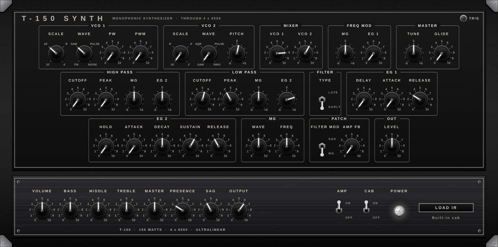

# T150 Synth

A monophonic synth plugin (VST3 / AU / standalone) modeled on the
**Korg MS-20** (its layout, how it's wired, and its sound), played
straight into the **T-150** tube amp and speaker cabinet.



## Download

Grab the latest zip for your computer from the
[**Releases**](../../releases) page:

- **T150-Synth-Windows.zip**: VST3 + standalone app
- **T150-Synth-Mac.zip**: VST3 + Audio Unit + standalone app (Apple Silicon and Intel, macOS 11+)

### Install on Windows
Copy `T150 Synth.vst3` into `C:\Program Files\Common Files\VST3`, rescan
plugins in your DAW, and load it on an instrument (MIDI) track.

### Install on Mac
Double-click `Install.command` (if macOS blocks it: right-click, Open, Open).
Restart your DAW.

## What's inside

```
VCO 1 ─┐
       ├─ MIXER ─ HIGH PASS ─ LOW PASS ─ VCA ─▶ T-150 AMP ─ CAB ─▶ out
VCO 2 ─┘                 ▲                          │
                         └──── AMP FB patch ────────┘
```

**Synth (top panel)**

| Section | Controls |
|---|---|
| **VCO 1** | Scale (32' 16' 8' 4'), Wave (triangle, saw, pulse, noise), PW (pulse width), PWM (MG sweeps the pulse width) |
| **VCO 2** | Scale (16' 8' 4' 2'), Wave (saw, square, narrow pulse, ring), Pitch (±1 octave, fine near the centre) |
| **Mixer** | VCO 1 and VCO 2 levels |
| **Freq Mod** | MG: vibrato from the MG. EG 1: pitch sweep up into each note |
| **Master** | Tune (±100 cents), Glide (portamento) |
| **High Pass / Low Pass** | Cutoff, Peak (resonance, up to self-oscillation), MG and EG 2 modulation amounts |
| **Filter** | EARLY (the original Korg35 filter: aggressive, screams when pushed) or LATE (the later OTA filter: smoother and rounder) |
| **EG 1** | Delay, Attack, Release. Drives the pitch sweep |
| **EG 2** | Hold, Attack, Decay, Sustain, Release. Drives both filters and the volume. As on the MS-20, the filter cutoff knobs set where the filter sits during sustain |
| **MG** | Wave (morphs falling saw to triangle to rising saw), Freq (0.1 to 20 Hz) |
| **Patch** | Filter Mod: MG or S&H (random steps, sampled at the MG rate). Amp FB: feeds the amp's output back into the filter |
| **Out** | Synth level going into the amp |

**Amp (bottom panel)**: the T-150, a tube amp inspired by the 1972
Sunn Model T. Volume, Bass, Middle, Treble, Master, Presence, Sag, Output,
an AMP switch to bypass it, a CAB switch, and Load IR for your own cabinet
impulse responses.

**Playing it:** one note at a time with low-note priority, like the
original (hold two keys and the lower one wins). Pitch bend is ±2
semitones, and the mod wheel adds MG vibrato.

Double-click any knob to reset it. Turning a knob shows its exact value.

## How it works

- The whole synth and the amp's tube stages run at **8x the sample rate**,
  so the oscillators, the screaming filters and the distortion stay clean
  and free of digital fizz.
- **Oscillators** use anti-aliased (PolyBLEP) saw and pulse waves. "Ring"
  combines VCO 1's pulse with VCO 2's square, like the MS-20 circuit.
- **Early filter**: a Korg35-style design with clipping placed only inside
  the resonance loop (where the real filter's diodes sit), so the resonance
  growls and screams while the rest of the sound passes at full level. The
  high-pass rolls off at 6 dB/octave and the low-pass at 12 dB/octave,
  matching Korg's schematics.
- **Late filter**: an OTA-style state-variable filter with soft saturation.
- A trace of analog-style noise lets a maxed-out filter start singing on
  its own, so you can play the filter as an oscillator.

## Build from source

You need CMake 3.22+, Git, and a C++17 compiler (Visual Studio 2022 on
Windows, Xcode on Mac). JUCE is downloaded automatically.

```
cmake -B build
cmake --build build --config Release
ctest --test-dir build -C Release
```

The plugin ends up in `build/T150Synth_artefacts/Release/`.

The tests check pitch accuracy, the filters and envelopes, low-note
priority, the amp's tone stack against the circuit math, and that
everything stays stable with every knob maxed out.

Pushing a version tag (for example `v0.1.0`) makes GitHub build both
platforms and attach the zips to a Release automatically.

## Credits

- Built with [JUCE](https://juce.com).
- Korg35 filter structure after Will Pirkle's virtual-analog filter work.
- Amp tone stack approach from Yeh & Smith, *"Discretization of the '59 Fender Bassman Tone Stack"* (DAFx 2006).

Korg, MS-20, Sunn and Model T are trademarks of their respective owners.
This project isn't affiliated with or endorsed by them; the names are used
only to describe the instruments that inspired it.
